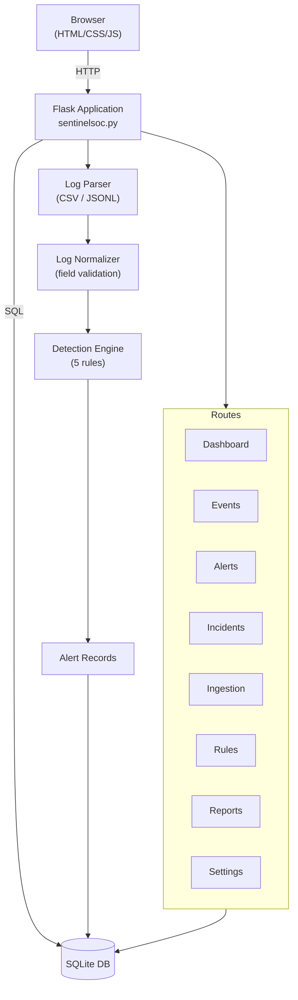
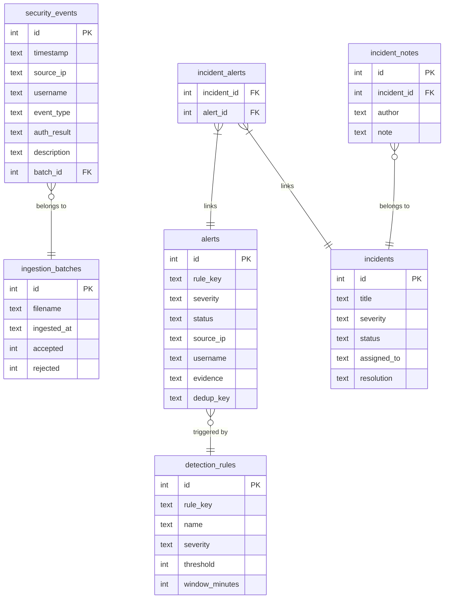

# SentinelSOC — Mini Security Operations Center

> **Detect. Investigate. Defend.**


---

## ⚠ Important Notice

This is an **educational prototype** built for the IBM Cybersecurity Bootcamp.

- All data is **synthetic demo data only**
- The application does **not** attack real systems, scan public targets, execute uploaded files, or perform automatic remediation
- It is **not suitable for production** without authentication, TLS, and proper access controls
- Run only on a trusted **local machine**

---

## 1. Project Overview

**SentinelSOC** is a defensive cybersecurity monitoring web application that simulates a
Mini Security Operations Center (SOC). It processes security logs, detects suspicious
authentication patterns using explainable rule-based detection, manages alerts and incidents,
and displays security information in a professional dark-mode dashboard.

### Problem Statement

Security Operations Centers face thousands of log events daily. Manually reviewing each one
is impractical. SentinelSOC demonstrates how rule-based detection can automatically surface
suspicious patterns — such as brute-force attempts and password spraying — so analysts can
focus on investigating meaningful alerts rather than raw log data.

### Objectives

1. Process CSV and JSON Lines security log files
2. Detect five categories of suspicious authentication behavior
3. Generate explainable alerts with supporting evidence
4. Allow analysts to manage alert status and create incidents
5. Export data and generate printable security reports
6. Provide a professional, usable security dashboard

---

## 2. Features

| Feature | Description |
|---|---|
| **Dashboard** | Real-time overview with event/alert counts, Chart.js charts, recent events |
| **Security Events** | Paginated event list with search, filter, and CSV export |
| **Alerts** | Rule-based alerts with evidence, status management, and incident creation |
| **Incidents** | Full incident lifecycle — notes, linked alerts, status, resolution |
| **Log Ingestion** | CSV and JSON Lines upload with validation summary and detection run |
| **Detection Rules** | Five configurable rules with explanations and alert counts |
| **Reports** | Aggregated metrics, trend charts, and printable security report |
| **Settings** | Per-rule threshold and window configuration; demo data reset |
| **CSV Export** | Events, alerts, and incidents — injection-safe |

---

## 3. Technology Stack

| Layer | Technology |
|---|---|
| Backend | Python 3.10+ / Flask 3.1 |
| Database | SQLite (WAL mode, parameterized queries) |
| Frontend | HTML5, CSS3, Vanilla JavaScript |
| Charts | Chart.js 4 |
| Icons | Lucide |
| Testing | pytest + pytest-cov |
| Dependencies | Flask, python-dotenv, pytest |

---

## 4. Architecture



---

## 5. Database Schema



---

## 6. Detection Rules

### Rule 1 — Repeated Failed Logins (Brute Force)
- **Trigger:** ≥5 failed login attempts from the **same source IP** within 5 minutes
- **Severity:** High
- **What it means:** May indicate automated password guessing against one or more accounts
- **What it does NOT mean:** A confirmed breach — failed attempts may be the result of a forgotten password
- **Recommendation:** Investigate the source IP; review affected accounts

### Rule 2 — Multiple-Account Login Failures (Password Spray)
- **Trigger:** ≥3 **distinct usernames** targeted from the same source IP within 10 minutes
- **Severity:** High
- **What it means:** May indicate password spraying (trying one common password against many accounts)
- **Recommendation:** Review all targeted accounts; investigate source IP

### Rule 3 — Successful Login After Repeated Failures
- **Trigger:** ≥3 failed attempts for the **same username + source IP** followed by a success within 10 minutes
- **Severity:** High
- **What it means:** Suspicious — could indicate a successful brute-force, or a user who recovered their password
- **Recommendation:** Verify with the account owner; review post-login activity

### Rule 4 — Account Lockout Spike
- **Trigger:** ≥5 account lockout events within 10 minutes
- **Severity:** Medium
- **What it means:** Multiple accounts being locked out simultaneously — possible automated attack
- **Recommendation:** Unlock affected accounts; identify source of failures

### Rule 5 — Suspicious Authentication Pattern (Multi-IP)
- **Trigger:** ≥3 **distinct source IPs** failing to authenticate the **same account** within 15 minutes
- **Severity:** Medium
- **What it means:** Possibly distributed attack or credential stuffing; could also be a user traveling
- **Recommendation:** Verify with account owner; check IP locations; preserve logs

---

## 7. Windows Setup Instructions

### Prerequisites
- Python 3.10 or newer ([python.org](https://www.python.org/downloads/))
- Git (optional)

### Step 1 — Get the code
```cmd
# Option A: Clone (if using git)
git clone <your-repo-url>
cd sentinelsoc

# Option B: Simply place sentinelsoc.py in a folder
```

### Step 2 — Create a virtual environment
```cmd
python -m venv venv
venv\Scripts\activate
```
You should see `(venv)` in your prompt.

### Step 3 — Install dependencies
```cmd
pip install -r requirements.txt
```

### Step 4 — Run the application
```cmd
python sentinelsoc.py
```

The application will:
1. Create the SQLite database (`sentinelsoc.db`) automatically
2. Insert synthetic demo data (events, alerts, incidents)
3. Start the Flask development server

### Step 5 — Open in browser
```
http://127.0.0.1:5000
```

---

## 8. Running Tests

```cmd
# Activate virtual environment first
venv\Scripts\activate

# Run all tests with verbose output
pytest tests/ -v

# Run with coverage report
pytest tests/ -v --cov=sentinelsoc --cov-report=term-missing
```

### Test Results
```
47 passed in ~55 seconds
```

### What is tested
| Category | Tests |
|---|---|
| CSV parsing | Valid file, missing columns, empty file, header-only, extra columns |
| JSON Lines parsing | Valid file, invalid lines, blank lines |
| Normalizer | Valid record, bad timestamp, missing event_type, invalid IP, auth mapping, timestamp formats, username truncation |
| Brute Force rule | Threshold trigger, below threshold, window boundary, duplicate prevention |
| Password Spray rule | Multiple accounts trigger, same account (no spray) |
| Success After Fail rule | Trigger on success after failures, no trigger on solo success |
| Lockout Spike rule | Spike trigger, below threshold |
| Multi-IP rule | Multiple IPs trigger |
| Empty database | Detection, dashboard, alerts page, incidents page |
| Alert status | Update, invalid status rejected, all valid statuses |
| Incidents | Create, empty title, add note, link alert, invalid alert ID |
| File upload | Valid CSV, valid JSONL, no file, invalid records reported |
| CSV export | Formula injection prevention, normal values unchanged, None handling |
| Database persistence | Events stored, alerts stored across connections |

---

## 9. Demo Scenarios

After starting the app, these scenarios are pre-loaded:

| Scenario | What to look for |
|---|---|
| **Brute Force** | Alert: "Repeated Failed Logins" from `198.51.100.42` targeting `alice.smith` |
| **Password Spray** | Alert: "Multiple-Account Login Failures" — 4 accounts targeted in < 10 min |
| **Success After Fail** | Alert: "Successful Login After Repeated Failures" for `bob.jones` |
| **Lockout Spike** | Alert: "Account Lockout Spike" — 7 lockouts detected |
| **Multi-IP** | Alert: "Suspicious Authentication Pattern" — 4 IPs targeting `charlie.dev` |

All source IPs use RFC 5737 documentation ranges (198.51.100.x, 203.0.113.x) — they are not real addresses.

### Demo walkthrough
1. Open **Overview** — note the event counts and charts
2. Click **Alerts** — see all 5 generated alerts
3. Click an alert — read the explanation and evidence
4. Update the alert status to "Investigating"
5. Click "Create Incident from Alert" — an incident is auto-created and linked
6. Open **Incidents** — add an investigation note
7. Go to **Log Ingestion** — upload a custom CSV file
8. Go to **Reports** — view the aggregated metrics and export CSV
9. Go to **Settings** — adjust rule thresholds and re-run detection
10. Go to **Settings → Reset Demo Data** to start fresh

---

## 10. File Upload Format

### CSV Format
Required columns: `timestamp`, `event_type`

Optional: `source_ip`, `username`, `auth_result`, `description`

```csv
timestamp,event_type,source_ip,username,auth_result,description
2024-01-15T08:30:00,authentication,192.168.1.10,alice.smith,success,Normal login
2024-01-15T08:31:00,authentication,198.51.100.1,alice.smith,failure,Bad password
2024-01-15T08:32:00,authentication,198.51.100.1,alice.smith,lockout,Account locked
```

Accepted timestamp formats:
- `2024-01-15T08:30:00`
- `2024-01-15 08:30:00`
- `15/01/2024 08:30:00`

Accepted `auth_result` values: `success`, `failure`, `lockout` (and common variants)

### JSON Lines Format
One JSON object per line:
```jsonl
{"timestamp":"2024-01-15T08:30:00","event_type":"authentication","source_ip":"192.168.1.10","username":"alice","auth_result":"success"}
{"timestamp":"2024-01-15T08:31:00","event_type":"authentication","source_ip":"198.51.100.1","username":"alice","auth_result":"failure"}
```

---

## 11. Project Files

```
sentinelsoc/
├── sentinelsoc.py          ← Complete application (single file)
├── requirements.txt        ← Python dependencies
├── README.md               ← This file
├── .env.example            ← Environment variable template
├── tests/
│   ├── __init__.py
│   └── test_sentinelsoc.py ← 47 automated tests
└── sentinelsoc.db          ← SQLite database (auto-created, not committed)
```

---

## 12. Security Controls Implemented

| Control | Implementation |
|---|---|
| SQL Injection | Parameterized queries throughout |
| XSS | Flask's Jinja2 auto-escaping; evidence displayed in pre-formatted box |
| Path Traversal | `os.path.basename()` on uploaded filenames |
| File Upload | Size limit (5 MB); content decoded safely; uploaded files not executed or stored on disk |
| CSV Injection | Dangerous cell values prefixed with `'` |
| Security Headers | X-Content-Type-Options, X-Frame-Options, X-XSS-Protection, Referrer-Policy |
| Input Validation | Status and severity values validated against allowlists |
| No Auto-Remediation | Application never blocks IPs, locks accounts, or executes commands |

---

## 13. Limitations

- **No authentication** — anyone with local network access can use the app; do not expose publicly
- **Single-file architecture** — intentionally simple for a bootcamp project; a production app would be modular
- **No real-time monitoring** — detection runs on upload/manual trigger, not as a streaming pipeline
- **Rule-based only** — no machine learning; novel attack patterns may not be detected
- **No TLS** — runs on HTTP; not suitable for production
- **Synthetic data only** — the detection rules are not tuned for production environments

---

## 14. Future Improvements

- [ ] Add user authentication (login, role-based access)
- [ ] Add TLS support
- [ ] Stream live syslog or Windows Event Log
- [ ] Add MITRE ATT&CK mapping to detections
- [ ] Add machine learning anomaly detection
- [ ] Email or webhook alerting
- [ ] Multi-tenant support
- [ ] REST API with token authentication

---

## 15. Responsible Use Statement

This application is built for **educational purposes only**.

- Do not use this tool to process real user credentials or actual authentication logs without appropriate authorization
- Detections indicate **suspicious behavior requiring investigation** — they do not confirm attacks
- Never automatically block IP addresses, lock accounts, or execute remediation based solely on these alerts
- Do not deploy this application publicly without adding authentication, TLS, and a proper security review

---

## 16. Presentation Script

### Opening (30 seconds)
"SentinelSOC is a Mini Security Operations Center I built from scratch. The problem it solves
is that SOC analysts face thousands of log events daily — they need tools to automatically
surface suspicious patterns so they can focus on real investigations."

### Architecture (1 minute)
"The application is a single Python file using Flask for the web server and SQLite for storage.
When you upload a log file, it's parsed and normalized, then the detection engine runs five
rule-based checks and generates alerts with evidence."

### Detection Rules (2 minutes)
Walk through each rule on the Detection Rules page, explaining what it detects and why it
matters. Emphasize that detections are *indicators for investigation*, not proof of attack.

### Live Demo (3 minutes)
1. Show the Dashboard — point to the event count and charts
2. Open an alert — read the description and evidence
3. Update alert status to "Investigating"
4. Create an incident — add a note
5. Upload a custom CSV — show the ingestion result
6. Run the detection engine — show new alerts

### Security Controls (1 minute)
"The application uses parameterized SQL queries, input validation, safe file upload handling,
and security headers. It never executes uploaded files or automatically takes remediation action."

### Closing (30 seconds)
"This demonstrates core SOC concepts — log ingestion, normalization, rule-based detection,
alert triage, and incident management — in a working, testable application."

---

*Built for the IBM Cybersecurity Bootcamp — Educational use only*
